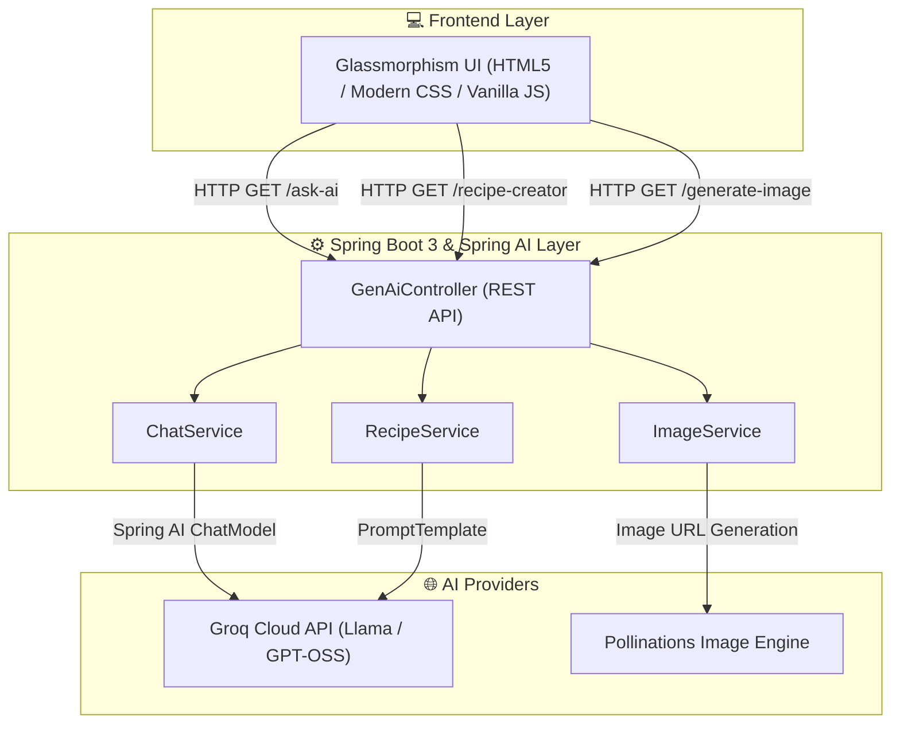

# 🌟 Spring AI Studio

[](https://www.oracle.com/java/)
[](https://spring.io/projects/spring-boot)
[](https://spring.io/projects/spring-ai)
[](https://www.docker.com/)
[](LICENSE)

> A modern, full-stack enterprise application harnessing **Spring AI** to deliver generative AI capabilities—including intelligent recipe synthesis, dynamic text-to-image generation, and conversational AI chat powered by high-speed Groq LLM inference.

---

## 📸 Key Features

| Feature | Description | Tech Used |
| :--- | :--- | :--- |
| 🍳 **AI Recipe Studio** | Synthesizes custom gourmet recipes from on-hand ingredients, preferred cuisine, and dietary requirements (e.g., vegan, gluten-free). | Spring AI Prompt Engineering & Groq LLM |
| 💬 **Conversational Chatbot** | Interactive conversational assistant delivering real-time, low-latency contextual responses. | Groq API (`openai/gpt-oss-120b`) |
| 🎨 **Generative Image Studio** | Transforms natural language prompts into high-resolution visuals on demand. | Pollinations AI Integration |
| 🛡️ **Zero-Leak Secret Design** | Decoupled configuration isolating local development keys from production cloud environments. | Spring Profiles & Environment Variables |
| 🐳 **Production Dockerized** | Multi-stage build container optimized for minimal image footprint and fast cloud cold-starts. | Eclipse Temurin Alpine JRE |

---

## 🏛️ System Architecture



---

## 🔌 REST API Endpoints

| Method | Endpoint | Query Parameters | Description |
| :--- | :--- | :--- | :--- |
| `GET` | `/ask-ai` | `prompt` *(String)* | Simple prompt-response chat with AI |
| `GET` | `/ask-ai-options` | `prompt` *(String)* | Configured chat with custom model temperature & options |
| `GET` | `/recipe-creator` | `ingredients`, `cuisine`, `dietaryRestrictions` | Generates structured recipes with ingredients & steps |
| `GET` | `/generate-image` | `prompt` *(String)* | Redirects to generated AI image stream |

---

## 🚀 Getting Started

### Prerequisites
- **Java 17 or 21** installed ([Download JDK](https://adoptium.net/))
- **Maven 3.8+** (or use the included `./mvnw`)
- A **Groq API Key** (Free at [console.groq.com](https://console.groq.com))

---

### Local Setup & Installation

1. **Clone the repository:**
   ```bash
   git clone https://github.com/prasad463-a/spring-ai-studio.git
   cd spring-ai-studio
   ```

2. **Configure Your API Key (Choose one):**

   - **Option A: Via Local Properties (Recommended for Dev)**  
     Create `src/main/resources/application-local.properties` (this file is ignored by Git to keep your key private):
     ```properties
     spring.ai.openai.api-key=your_groq_api_key_here
     ```

   - **Option B: Via Environment Variable**  
     **Windows (PowerShell):**
     ```powershell
     $env:GROQ_API_KEY="your_groq_api_key_here"
     ```
     **Linux / macOS:**
     ```bash
     export GROQ_API_KEY="your_groq_api_key_here"
     ```

3. **Run the Application:**
   ```bash
   # Windows
   .\mvnw.cmd spring-boot:run

   # macOS / Linux
   ./mvnw spring-boot:run
   ```

4. **Access the Web Studio:**  
   Open your browser and navigate to:  
   👉 **`http://localhost:8080`**

---

## 🐳 Docker Support

You can build and run the entire project in an isolated container:

```bash
# 1. Build the Docker image
docker build -t spring-ai-studio .

# 2. Run the container
docker run -p 8080:8080 -e GROQ_API_KEY="your_groq_api_key_here" spring-ai-studio
```

---

## ☁️ Deployment

The repository is pre-configured for one-click continuous deployment on **Render**, **Railway**, or **Koyeb**:

1. Link this repository to your cloud host.
2. The platform automatically detects the multi-stage **`Dockerfile`**.
3. Set the environment variable:
   - `GROQ_API_KEY` = `your_api_key`
4. The service will dynamically bind to `$PORT` and launch live!

---

## 🧪 Testing

Automated integration tests verify live connectivity with the AI services:

```bash
# Run all unit and integration tests
./mvnw test
```

---

## 🛠️ Tech Stack & Dependencies

- **Framework**: [Spring Boot 3](https://spring.io/projects/spring-boot)
- **AI Integration**: [Spring AI](https://spring.io/projects/spring-ai) (OpenAI Model Starter)
- **LLM Inference**: [Groq Cloud](https://groq.com/) (`openai/gpt-oss-120b`)
- **Image Generation**: [Pollinations AI](https://pollinations.ai/)
- **Frontend**: Responsive Glassmorphism Dark UI (HTML5, Modern CSS, Fetch API)
- **Containerization**: Docker (Eclipse Temurin JRE Alpine)

---

## 👤 Author

**Prasad**  
- **GitHub**: [@prasad463-a](https://github.com/prasad463-a)
- **LinkedIn**: [Connect with me on LinkedIn](https://www.linkedin.com/)

---

## 📄 License

This project is licensed under the MIT License - feel free to use and adapt it for your own applications!
